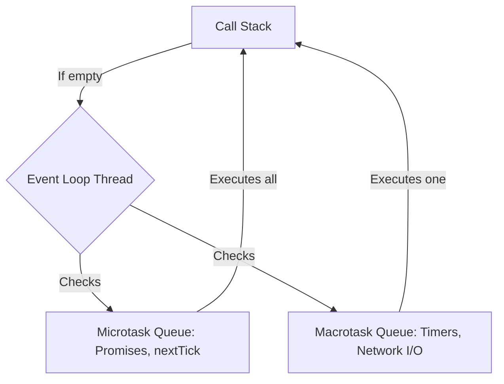

# Concurrency, Promises, and I/O: The Async Event Loop Model

Node.js is a single-threaded runtime that achieves high-throughput concurrent execution using an asynchronous, non-blocking I/O event loop. 

A junior engineer who believes Javascript executes threads concurrently will inevitably write race conditions, block the main execution loop, or leave uncaught promise rejections that crash production servers.

---

## The Node.js Event Loop Architecture

The event loop delegates heavy operating system interactions (file access, network sockets, crypto, timers) to the libuv threadpool or system kernels. When these operations complete, their callbacks are enqueued in task queues.



1. **Call Stack**: Synchronous execution of frames.
2. **Microtask Queue**: Executed immediately after the current call stack clears (e.g., `Promise.then` resolution, `process.nextTick`). **All** microtasks are drained before the loop proceeds.
3. **Macrotask Queue**: Executed in subsequent phases (e.g., timers like `setTimeout`, I/O, sockets). Only **one** macrotask is processed per phase if microtasks are waiting.

---

## Async/Await Under the Hood

The `async/await` syntax is syntactic sugar built over native Promises and Generator closures. An `await` keyword does not block the thread; it suspends the local execution frame, places the remaining lines of the function into the Microtask Queue, and frees the main call stack to process other events.

Let's analyze a production async execution path in the notification module:
[backend/src/modules/notifications/notification.service.ts:50-57](backend/src/modules/notifications/notification.service.ts#L50-L57):

```typescript
  static async sendApprovalRequested(taskId: string) {
    const task = await prisma.onboardingTask.findUnique({
      where: { id: taskId },
      include: { onboardingCase: { include: { employeeProfile: true } } },
    });
```

When this service function executes:
1. `prisma.onboardingTask.findUnique` is called. It creates an asynchronous database query through native C++ bindings.
2. The runtime encounters the `await` statement. It suspends execution of `sendApprovalRequested`, packages the remaining lines of this function as a microtask callback, and immediately returns execution control to the main event loop.
3. While the database is fetching records, the single main thread processes other inbound Express requests or network dispatches.
4. Once the database returns a result, the microtask callback is pushed to the Microtask Queue, ready to resume execution when the call stack clears.

> **Senior aside:** *Never block the single main thread with expensive CPU calculations (such as massive JSON parsing or recursive loops). If the stack is busy calculating, it cannot drain the macrotask queue to accept incoming TCP requests, leading to severe latency spikes and gateway timeouts.*

---

## Concurrency Race Conditions

Because Node.js is single-threaded, two pieces of Javascript code never execute at the *exact* same millisecond. However, race conditions occur over the lifespan of asynchronous steps.

Consider this illustrative code that shows how a naive check-and-update flow creates a race condition:

```ts
// Illustrative — not from the repo
async function reserveITEquipment(equipmentId: string) {
  const item = await db.equipment.findUnique({ where: { id: equipmentId } });
  if (item.isReserved) {
    throw new Error("Item already allocated!");
  }
  // RACE GAP: While this line awaits, another request could execute the exact same check!
  await db.equipment.update({ where: { id: equipmentId }, data: { isReserved: true } });
}
```

To prevent this type of race condition in database operations, you must leverage **database transactions** or atomic queries, as seen in the transactional setup for onboarding case creations:
[backend/src/modules/onboardingCases/onboardingCases.service.ts:236-239](backend/src/modules/onboardingCases/onboardingCases.service.ts#L236-L239).

---

## Pitfall Checklist

1. **Unprotected Asynchronous Checks**: Performing a database lookup, modifying a state, and saving it without transaction isolation or lock controls.
2. **Missing `await` inside Try/Catch**: Returning an unawaited Promise from inside a try/catch block. The parent function exits, and the rejection escapes the boundary uncaught.
3. **Execution Blockage in Loop**: Using `await` inside a standard loop, forcing requests to execute sequentially instead of concurrently via `Promise.all()`.
4. **Unhandled Promise Rejection**: Creating a Promise and failing to catch rejections, which can lead to termination of the Node process in modern versions.
5. **Event Loop Starvation**: Running heavy CPU tasks (like large-file cryptographic hashing or massive text sorting) on the main thread instead of offloading to worker threads.
6. **Concurrent State Mutation**: Mutating a shared global variable inside an async function across multiple concurrent requests.
7. **BullMQ Worker Blocking**: Executing long-running sync code inside a worker block, preventing heartbeat checks and leading to double processing errors.
8. **Timer Precision Failures**: Assuming `setTimeout(fn, 1000)` executes in exactly 1.000 seconds. Timer execution is subject to Event Loop lag.

---

## Drills

1. **Async Execution Trace**: Trace the function `sendApprovalRequested` at [backend/src/modules/notifications/notification.service.ts:50-70](backend/src/modules/notifications/notification.service.ts#L50-L70). Identify every asynchronous boundary and map where the thread yields control to the event loop.
2. **Event Loop Order Prediction**: Predict the output order of execution for a script containing a nested promise, `process.nextTick`, and a `setTimeout(fn, 0)`. Write the script in your scratch folder and execute it to test your theory.
3. **Vitest Async Mocking**: Open [backend/src/modules/onboardingCases/__tests__/onboardingProgress.service.test.ts:31-40](backend/src/modules/onboardingCases/__tests__/onboardingProgress.service.test.ts#L31-L40) and write down how the mock promises resolved asynchronously during testing.
