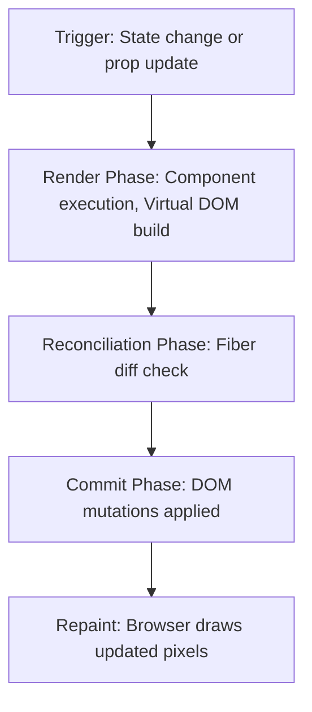

# The Fiber Loop and DOM Reconciliation: How React Renders

For a junior engineer, React rendering often feels like magic. A failure to understand the exact lifecycle from a state change to a physical browser repaint leads to redundant renders, lost user focus, and heavy performance bottlenecks.

---

## The React 18 Render and Commit Model

React updates the screen in a two-phase process: **Render** and **Commit**.



1. **Triggering a Render**: Occurs when a component's state or props change, or the parent component re-renders.
2. **The Render Phase**: React calls your component function to determine what the UI should look like. This build step returns a Virtual DOM tree.
3. **Reconciliation (Fiber Diffing)**: React compares the new Virtual DOM tree with the previous one. It identifies the minimum set of changes required to synchronize the physical DOM.
4. **The Commit Phase**: React applies these changes to the physical browser DOM.
5. **Browser Repaint**: The browser updates the layout and repaints the screen.

> **Senior aside:** *The Render Phase is purely mathematical and must be a pure function. Side effects, network calls, or direct state mutations inside the component function body are dangerous and cause unpredictable rendering loops.*

---

## Why Keys Matter in Dynamic Lists

When rendering lists of elements, React relies on the `key` prop to identify which items have changed, been added, or been removed.

Look at this real implementation inside the cases dashboard:
[frontend/src/pages/CasesList.tsx:161-164](frontend/src/pages/CasesList.tsx#L161-L164):

```typescript
            {filteredCases.map((c) => (
              <tr key={c.id} className="border-b border-slate-100 dark:border-slate-800 hover:bg-slate-50/50 dark:hover:bg-slate-900/30 transition-colors">
```

### Why `key={c.id}` Is Crucial:
1. **Preserving Component Identity**: The `key` uniquely maps the virtual node to its physical DOM element. If the list is sorted, filtered, or prepended, React simply shifts the DOM node instead of deleting and rebuilding it.
2. **Preventing State Loss**: If rows contain internal state (like inputs or toggles), using index-based keys (`key={index}`) causes React to map state incorrectly when items are rearranged.

---

## Pitfall Checklist

1. **Using Array Index as Keys**: `key={index}` breaks list identity when items are reordered, leading to state leaks and performance lags.
2. **Direct State Mutations**: Modifying state in-place (e.g., `state.push(item)`) instead of passing a new reference block.
3. **Triggering Side Effects in Render**: Placing network calls, global subscriptions, or manual DOM manipulations directly in the component function body.
4. **Inline Function Declarations in Props**: Passing inline anonymous functions `onClick={() => doSomething()}` to child components, triggering unnecessary child re-renders.
5. **Accidental Infinite Render Loops**: Updating state inside the main component body, triggering a re-render that updates state again, leading to crashes.
6. **Mismatched Key Scopes**: Re-declaring key generators that return fresh random strings `key={Math.random()}` on every render.
7. **Nested Component Declarations**: Declaring a functional component inside another component body. This causes the child component to completely unmount and remount on every render.
8. **Ignoring Hook Rules**: Placing hooks inside conditionals, loops, or nested functions, breaking React's hook call order.

---

## Drills

1. **Key Identity Test**: Open [frontend/src/pages/CasesList.tsx:161-165](frontend/src/pages/CasesList.tsx#L161-L165). Temporarily replace `key={c.id}` with `key={Math.random().toString()}`. Observe the browser behavior, paying attention to what happens when you type into search filters or click row toggles.
2. **Render Counter**: Add a simple `console.log("Component Rendered")` statement to a page component. Perform various actions (such as typing in search fields or opening overlays) and count the number of renders.
3. **Pure Function Check**: Review a page component's file. Ensure that all computations inside the main render scope are pure and contain no hidden side effects.
