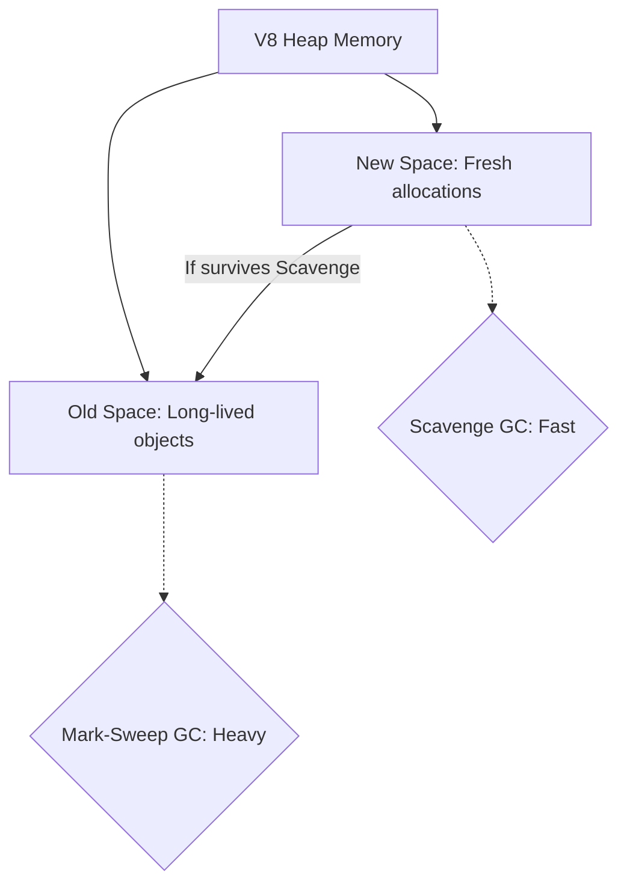

# Garbage Collection, Heap Limits, and V8: Node Runtimes Explained

When deploying Node.js servers, you are executing code inside Google's V8 engine wrapper. A failure to understand heap allocations, V8 garbage collection heuristics, or thread scaling limits will lead to out-of-memory crashes and resource leakage under high-concurrency production workloads.

---

## V8 Engine Memory Structures: Heap and Stack

* **Stack**: Stores primitive values and function call frame pointers. Allocations are cheap and managed automatically by the call stack.
* **Heap**: Stores all complex objects, array arrays, database models, and closure contexts. The Heap is divided into distinct zones:
  * **New Space (Young Generation)**: Tiny area where fresh allocations occur. Fast, lightweight garbage collection runs frequently here.
  * **Old Space (Old Generation)**: Larger area where long-lived objects are promoted. Heavy garbage collection sweep passes run here, which can freeze the main thread's execution loop.



---

## Scaling Node: Single Thread vs. Multi-Process Clustering

Because Node is single-threaded, it cannot naturally leverage multi-core CPUs. A single Express instance runs on a single CPU core. To scale, we must run multiple instances of our Node server behind a reverse proxy (like NGINX) or leverage the built-in `cluster` module to spawn process forks that share a TCP port boundary.

We manage heavy asynchronous processing in our codebase using background job queues:
[backend/src/jobs/worker.ts:25-28](backend/src/jobs/worker.ts#L25-L28):

```typescript
  const worker = new Worker(
    NOTIFICATION_QUEUE_NAME,
    async (job) => {
```

### Why Offloading Jobs is Critical:
1. **Thread Preservation**: Dispatched tasks (like generating PDFs or sending transactional emails) are processed inside a separate worker process or in non-blocking promise loops. The main Express server thread remains free to accept incoming API requests.
2. **Crash Isolation**: If an unhandled database parsing exception crashes the background worker, the main server process is unaffected and continues serving clients.

> **Senior aside:** *Never perform CPU-intensive tasks directly in API request handlers. Offload them to external queue workers or run them in separate thread boundaries to keep request latency low.*

---

## Pitfall Checklist

1. **Closure Memory Leaks**: Holding references to large context variables inside long-lived scopes, preventing V8 garbage collection.
2. **Exceeding Heap Allocations**: Running queries that pull millions of database rows into memory at once, triggering V8 heap limit crashes.
3. **Blocking Main Callstack**: Performing expensive sync calculations (like loops over large datasets) directly in Express router callbacks.
4. **Failing to Monitor Heap Usage**: Deploying servers without tracing V8 memory trends or setting `max-old-space-size` flags.
5. **Worker Heartbeat Timeout Blocks**: Running synchronous code inside BullMQ workers that blocks internal polling tasks.
6. **Unhandled CPU Starvation**: Running infinite loops that consume 100% of CPU cycles, preventing any new connections.
7. **Cluster Shared Memory Bugs**: Storing temporary data (like user sessions or tokens) in local server memory instead of a shared store (like Redis), causing requests to fail when routed to different process clusters.
8. **Excessive Process Spawning**: Spawning more worker process clusters than physical CPU cores, causing resource thrashing.

---

## Drills

1. **Memory Profile Check**: Write a basic script that monitors local server heap memory using `process.memoryUsage()`. Execute a heavy loop in your scratch folder and watch the memory usage grow.
2. **Queue Offloading Review**: Open [backend/src/jobs/worker.ts](backend/src/jobs/worker.ts) and trace how the background worker handles incoming notification dispatches.
3. **V8 Flag Audit**: Search the web for the `--max-old-space-size` Node configuration flag. Explain why setting this parameter in container environments is necessary to prevent silent container termination.
