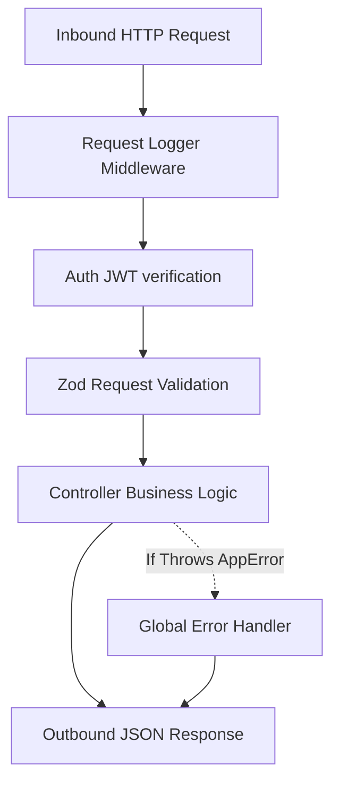

# Middleware pipelines, Contexts, and Handlers: Express Request Lifecycles

An Express server acts as an HTTP pipeline processing inbound TCP sockets. A junior engineer who treats Express handlers as standalone blocks will inevitably leak database connections, leave requests hanging, or scatter duplicate request validation logic across every route.

---

## The Middleware Execution Pipeline

Every incoming HTTP request passes through a sequential chain of functions (middleware) before executing the final controller action.



1. **Request Logger**: Tracks connection times and metadata.
2. **Auth Verification**: Extracts bearer tokens, populates `req.user`, and verifies active sessions.
3. **Request Validator**: Sanitizes and rejects invalid payloads before business logic executes.
4. **Controller Action**: Executes core features.
5. **Global Error Handler**: Catches all thrown exceptions and formats clean responses.

---

## Intercepting and Sanitizing Payloads with Zod Middleware

To protect business logic layers, we validate request bodies at the entry portal using generic Zod middleware.

Inspect this implementation:
[backend/src/shared/middleware/validation.middleware.ts:6-14](backend/src/shared/middleware/validation.middleware.ts#L6-L14):

```typescript
export function validateRequest(schema: ZodSchema) {
  return (req: Request, res: Response, next: NextFunction) => {
    const result = schema.safeParse(req.body);
    if (!result.success) {
      const errors = result.error.errors.map(err => ({
        field: err.path.join('.'),
        message: err.message,
      }));
```

### Why This Design Is Superior:
1. **Separation of Concerns**: Controllers assume that all input variables (e.g. UUID formats or string lengths) are correct. No manual parsing or parameter validation checks clutter the service layer.
2. **Clean Fail-Fast**: If validation fails, `res.status(400).json({ errors })` is returned immediately. The controller is never instantiated, conserving memory and database query overhead.
3. **Guaranteed Type Safety**: Succeeding blocks can safely access verified fields knowing they conform to the schema constraints.

---

## The Catch-All Global Error Boundary

In modern servers, manual try/catch blocks are avoided inside controllers. Instead, we use an asynchronous handler wrapper to catch exceptions and forward them to a centralized global error boundary.

Inspect our global error handler middleware:
[backend/src/shared/middleware/errorHandler.ts:11-20](backend/src/shared/middleware/errorHandler.ts#L11-L20):

```typescript
export const errorHandler = (
  err: Error,
  req: Request,
  res: Response,
  next: NextFunction
) => {
  if (err instanceof AppError) {
    return res.status(err.statusCode).json({
      code: err.errorCode,
      message: err.message,
      errors: err.errors,
    });
```

> **Senior aside:** *Never log stack traces to clients in production. Returning raw exceptions leaks internal file paths and database query architectures to the public web, inviting security exploits.*

---

## Pitfall Checklist

1. **Missing `next()` in Middleware**: Failing to call `next()`, causing requests to hang until client timeout.
2. **Scattered Try/Catch Blocks**: Writing verbose try/catch wrappers in every controller instead of using a global error boundary.
3. **Leaking Internal Stack Traces**: Returning raw backend exceptions or database parser statements to the client.
4. **Mismatched Middleware Order**: Placing request validation middleware *before* auth checks, allowing unauthenticated requests to consume validation cycles.
5. **Direct Mutation of the `req` Object**: Attaching unstructured properties to `req` instead of declaring safe properties inside Express declaration blocks.
6. **No Request Payload Limit**: Failing to set limit filters on `express.json()`, allowing attackers to crash servers with massive payloads.
7. **Ignoring Asynchronous Failures**: Failing to wrap async controller methods with an `asyncHandler`, causing unhandled process terminations on rejection.
8. **Double Send Errors**: Attempting to call `res.json()` twice inside the same handler, triggering "Headers already sent" runtime warnings.

---

## Drills

1. **Middleware Pipeline Audit**: Open [backend/src/modules/onboardingCases/onboardingCases.routes.ts:31-34](backend/src/modules/onboardingCases/onboardingCases.routes.ts#L31-L34). List every middleware executed in order when an HR Admin requests workflow launches.
2. **Middleware Writing**: Create a simple middleware `requestTimeTracker` inside a test file that tracks the exact duration in milliseconds from request receipt to response delivery, printing results to the logs.
3. **Error Boundary Test**: Temporarily write `throw new AppError('TEST_CRASH', 500)` inside a controller action. Trigger the route and verify the exact JSON payload returned to the browser.
