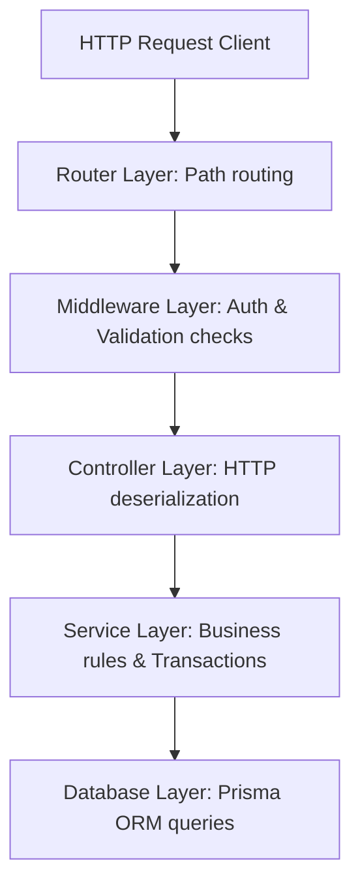

# Component Isolation and Dependency Scopes: Architectural Layering

A clean architecture separates concerns by organizing code into distinct horizontal layers. A junior engineer who mixes transport protocols (like HTTP `req` or `res` objects) directly into database query modules makes testing impossible, introduces duplicate logic, and couples the app to a single web framework.

---

## The Monorepo Layer Architecture

Every request flowing through our Express backend navigates through five distinct execution layers:



1. **Router Layer**: Directs URL paths to their respective handler entry points.
2. **Middleware Layer**: Enforces authentication, verifies RBAC permissions, and validates inputs.
3. **Controller Layer**: Deserializes query parameters, handles JSON payload conversions, and delegates to services. **Controllers never execute direct database queries.**
4. **Service Layer**: Coordinates transactional business logic, aggregates metrics, and enforces state machine transitions. **Services are completely web-framework agnostic.**
5. **Database Layer (Prisma ORM)**: Executes structured SQL queries and manages data model maps.

---

## Verifying Layer Boundaries in Code

Let's inspect how this routing boundary is constructed:
[backend/src/modules/onboardingCases/onboardingCases.routes.ts:31-34](backend/src/modules/onboardingCases/onboardingCases.routes.ts#L31-L34):

```typescript
router.post(
  '/:id/start',
  requirePermission(Permissions.START_ONBOARDING),
  asyncHandler(OnboardingCasesController.startOnboardingCase)
);
```

And trace how the controller handles the request without touching database queries directly:
[backend/src/modules/onboardingCases/onboardingCases.controller.ts:47-52](backend/src/modules/onboardingCases/onboardingCases.controller.ts#L47-L52):

```typescript
  static async startOnboardingCase(req: Request, res: Response) {
    const caseId = req.params.id;
    const actorId = req.user!.id;

    const result = await OnboardingCasesService.startOnboardingCase(caseId, actorId);
```

### Why This Boundary Matters:
1. **Framework Decoupling**: If we replaced Express with Hono or Fastify tomorrow, we would rewrite only the routing and controller layers. The heavy transactional business logic inside `OnboardingCasesService` remains completely untouched.
2. **Deterministic Testing**: Because services do not reference HTTP `req` or `res` parameters, you can test them directly inside unit tests by passing standard strings, avoiding the need to mock complex Express response objects.

> **Senior aside:** *Never pass Express `req` or `res` arguments into service layers. Services must consume only primitive parameters or structured DTO objects, ensuring they can be executed by CLI tools, queues, or other interfaces.*

---

## Pitfall Checklist

1. **Leaking HTTP Context into Services**: Passing `req` or `res` objects into service methods, coupling business logic to Express.
2. **Executing Direct DB Queries inside Controllers**: Writing `prisma.user.findFirst` directly inside controller handlers to skip writing a service file.
3. **Direct Output Writing in Services**: Attempting to write HTTP response outputs (`res.send`) inside service actions.
4. **Circular Layer References**: Writing a service that imports a controller to access utility methods, creating compilation loops.
5. **Validation Scattered Across Layers**: Validating parameters both in middlewares, controllers, and database modules instead of organizing sanitization at boundaries.
6. **No Scoped Data Objects (DTOs)**: Exposing database model entities directly to clients without mapping them to structured schema contracts first.
7. **Ignoring Dependency Isolation Rules**: Importing browser-specific frontend libraries inside backend server utilities.
8. **Mismatched Controller Error Handlers**: Failing to wrap controller async calls in `asyncHandler`, allowing rejected promises to crash processes.

---

## Drills

1. **Layer Dependency Review**: Open [backend/src/modules/onboardingCases/onboardingCases.controller.ts](backend/src/modules/onboardingCases/onboardingCases.controller.ts) and verify that no direct database interactions occur.
2. **DTO mapping implementation**: Write a simple mapper utility `mapUserToDTO` inside a user service file that accepts a Prisma User model and returns a clean, sanitized object that omits the password hash.
3. **Mock Request Testing**: Write a unit test script that invokes a service action directly by passing simple mock strings to verify the action behaves deterministically without mock servers.
