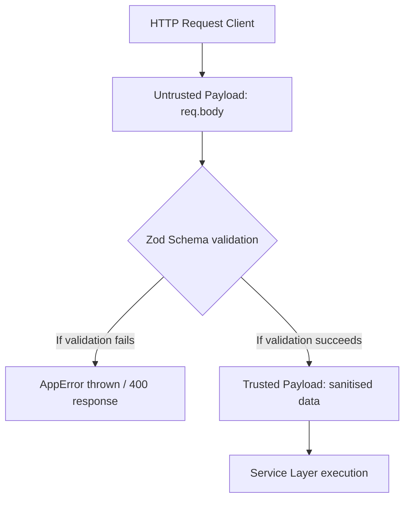

# Input Sanitization and Trust Levels: Validation and Boundaries

Software architectures are defined by boundaries. One of the most important boundaries is where untrusted external data (such as HTTP request payloads) becomes trusted internal data. 

A junior engineer who does not validate parameters at the system portal exposes database layers to injection attacks, logic corruption, and invalid entries.

---

## The Boundary Model: Untrusted to Trusted Data

When an HTTP request hits our API portal, we treat the payload as highly untrusted.



Our system enforces validation boundaries at two separate levels:
1. **Entry Portals**: Validates the payload layout (types, lengths, string constraints) using Zod schemas before executing business logic.
2. **Database Invariants**: Relational constraints, unique indexes, and foreign key boundaries managed by the DB engine via Prisma.

---

## Schema Integrations inside Route Portals

Let's inspect how request validations are mounted directly inside Express routes:
[backend/src/modules/onboardingCases/onboardingCases.routes.ts:18-22](backend/src/modules/onboardingCases/onboardingCases.routes.ts#L18-L22):

```typescript
router.post(
  '/',
  requirePermission(Permissions.CREATE_CASE),
  validateRequest(createOnboardingCaseSchema),
  asyncHandler(OnboardingCasesController.create)
);
```

By placing `validateRequest(createOnboardingCaseSchema)` in the route sequence, the route pipeline blocks any payload that violates the schema layout. If a user passes an invalid UUID for the department or an incorrect date format, the request fails with a `400 Bad Request` before the controller action is even invoked.

> **Senior aside:** *Always validate strings for length and structure constraints. Accepting plain strings without length controls allows attackers to cause database overflow or denial of service by submitting massive payloads.*

---

## Pitfall Checklist

1. **Bypassing Route Validation**: Reading raw query inputs inside controllers without validating them against a schema first.
2. **Duplicating Schema Configurations**: Manually maintaining frontend Zod schemas and backend Zod schemas instead of sharing schemas via a monorepo workspace.
3. **No Length Constraints on Strings**: Declaring `z.string()` without mapping `min()` or `max()` boundaries to prevent overflow exploits.
4. **Ignoring Sanitization Utilities**: Failing to trim strings before validation, allowing users to enter blank values.
5. **Permissive UUID Validations**: Validating unique fields as plain strings instead of calling `z.string().uuid()`.
6. **Mismatched Date Formats**: Accepting raw timestamps without enforcing ISO date validations.
7. **Ignoring Nested Validation Failures**: Failing to recursively validate nested arrays of child objects.
8. **Loose Enum Constraints**: Accepting string payloads that do not match the system's exact enum states.

---

## Drills

1. **Schema Extension Check**: Open [backend/src/modules/onboardingCases/onboardingCases.schemas.ts:6-14](backend/src/modules/onboardingCases/onboardingCases.schemas.ts#L6-L14). Add a new schema constraint that requires `preferredName` to be a string of at least 3 characters and at most 50 characters.
2. **Schema Integration Audit**: Trace a route file and locate every validator middleware. Verify that every POST and PATCH request is protected by a matching schema.
3. **Regex Validation Construction**: Research Zod's regex matching capabilities. Write a validation constraint that accepts only corporate email addresses ending in `@company.com`.
