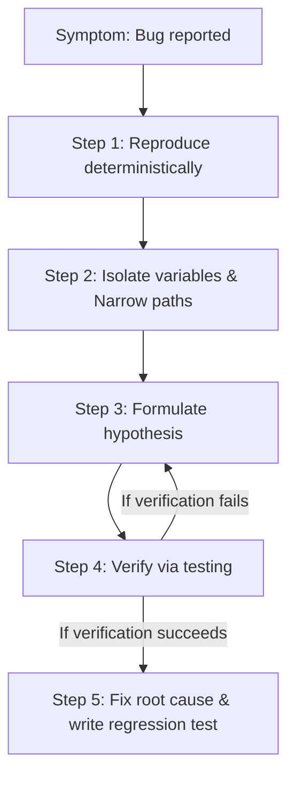

# Scientific Isolation and Root Cause Analysis: Systematic Debugging

Debugging is not random guessing. When a system crashes under high load, a junior engineer will desperately change lines of code blindly hoping to fix the issue. A senior engineer approaches debugging scientifically: reproducing the error, isolating variables, formulating hypotheses, and verifying the root cause.

---

## The Scientific Debugging Method



1. **Reproduce Deterministically**: Write an automated test script that triggers the failure consistently. If you cannot reproduce the bug, you cannot prove it is fixed.
2. **Isolate Variables (Narrow Paths)**: Strip out unrelated modules. Isolate the issue to a specific SQL query, frontend component render loop, or middleware intercept.
3. **Formulate a Hypothesis**: Explain *why* the bug is occurring using your mental model of the runtime and database layers.
4. **Verify through Testing**: Write a failing test assertion that catches the issue under the current state.
5. **Fix the Root Cause**: Implement the cleanest, most localized fix. Ensure that a regression test is written to protect this path from future modifications.

---

## Case Study: Graceful Offline Redis Recovery

Let's look at a real-world resilience engineering pattern in our codebase. Under standard production loads, the notification engine relies on BullMQ and Redis to execute tasks in the background.

But during local development, forcing developers to have a running Redis container can be a barrier to entry. We solve this by implementing an automatic, non-blocking **Queue Fallback Mechanism**:
[backend/src/modules/notifications/notification.service.ts:31-38](backend/src/modules/notifications/notification.service.ts#L31-L38):

```typescript
      // If Redis connection is offline, execute using in-memory background promise timeout
      console.warn('⚠️ Notification Queue connection issues. Using in-memory fallback.');
      setTimeout(async () => {
        try {
          await this.processNotificationImmediate(taskId);
        } catch (err) {
          console.error('In-memory notification processing failed:', err);
        }
      }, 0);
```

### Why This Architecture Is Highly Resilient:
1. **Fallback Strategy**: If ioredis throws a connection error, the service catches the exception, prints a clear warning, and schedules the email dispatch task on Node's Event Loop using a non-blocking `setTimeout` macro-task.
2. **Zero In-Band Lag**: The immediate function execution is placed inside a zero-millisecond timeout callback. This immediately yields control back to the event loop, ensuring that Express requests are not blocked by email SMTP operations.

> **Senior aside:** *Always design systems to fail closed for security, but fail open or fallback gracefully for local development runtime configurations. If a non-critical feature (such as email logging) crashes the main server, your platform is fragile.*

---

## Pitfall Checklist

1. **Blind Code Mutations**: Making random changes in code files hoping to resolve an error without isolating variables first.
2. **No Regression Tests**: Fixing a bug without writing an automated test, allowing the regression to reappear in future releases.
3. **Ignoring Log Warning Levels**: Treating system warning statements (like Redis connection alerts) as noise, letting logs get polluted.
4. **Suppressing Exception Outputs**: Writing empty catch blocks `catch (e) {}` that silence crashes and obscure root causes.
5. **Debugging without Profilers**: Trying to isolate rendering lag without inspecting the browser's React Profiler.
6. **Mismatched Dev/Prod Configs**: Debugging a bug locally using SQLite when production runs PostgreSQL, missing database-specific lock issues.
7. **Ignoring Stack Traces**: Reading only the top-level error message instead of tracing the full execution stack.
8. **Mismatched Timezone Assumptions**: Hardcoding timezone values when debugging date offset issues.

---

## Drills

1. **Log Level Audit**: Open [backend/src/modules/notifications/notification.service.ts](backend/src/modules/notifications/notification.service.ts). Locate where in-memory fallback logs are written and identify their warning levels.
2. **Mocking a Connection Crash**: Temporarily disconnect your local background database container. Trigger a request and verify that the Express exception handler correctly returns a structured JSON payload instead of crashing the Node process.
3. **Event Loop Debugging**: Write a script in your scratchpad that contains a heavy calculation loop. Execute it and analyze how it impacts Event Loop delays.
