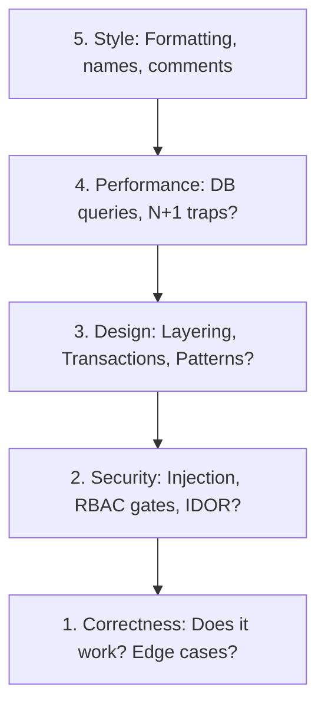

# Peer Mentoring and Review Ethics: Code Review Mindset

A senior engineer views code reviews not as a gateway to catch typos, but as a mentoring loop to build shared architectural alignment. 

---

## 1. The Code Review Hierarchy of Needs

When reviewing a pull request, organize your feedback across these priority bounds:

* **Style & Formatting**: Let automated tools (ESLint, Prettier) handle this. Never waste time debating spaces, brackets, or semicolons in manual comments.

---

## 2. Delivering Constructive Architectural Feedback

As a senior, your tone must be peer-to-peer and Socratic, not authoritarian. Frame criticisms as open design questions:

* **Authoritarian (Bad)**: *"Don't write this query in the controller, it breaks layering. Move it to a service file."*
* **Socratic & Constructive (Senior)**: *"I noticed we are querying the database directly inside this controller handler. What do you think about extracting this query into `UserService`? This would let us test the business logic in isolation without having to mock Express request contexts, keeping the controller layer clean."*

### Key Guidelines:
1. **Explain the 'Why'**: Always explain the architectural reason behind your recommendation (e.g. testability, coupling, connection limits).
2. **Highlight the Good**: Praise clean implementations, elegant helper modules, and robust test setups.
3. **Keep it local**: Focus on the code, not the author. Use "we" instead of "you".
